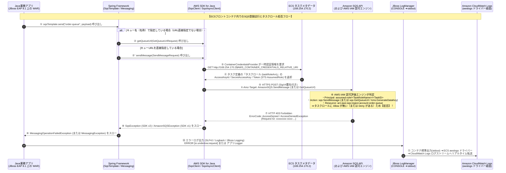

# ECS(フロントコンテナ / JBoss EAP 8.1 + Spring + AWS SDK) から SQS への書き込みがタスクロールにより拒否された際の完全調査・設定ガイド

---

## 目次

1. [はじめに：本事象の全体像と「3つの質問」への最短結論サマリー](#1-はじめに本事象の全体像と3つの質問への最短結論サマリー)
2. [小学生にもわかる！このシステムの仕組みと「なぜ名札（タスクロール）で断られるのか」](#2-小学生にもわかるこのシステムの仕組みとなぜ名札タスクロールで断られるのか)
3. [登場の歴史・背景・なぜこの構成と「ECSタスクロール」が必要になったのか（技術進化の経緯）](#3-登場の歴史背景なぜこの構成とecsタスクロールが必要になったのか技術進化の経緯)
4. [内部動作の完全解剖：JBoss EAP 8.1 + Spring + AWS SDK が SQS に拒否されるまでのコールスタック](#4-内部動作の完全解剖jboss-eap-81--spring--aws-sdk-が-sqs-に拒否されるまでのコールスタック)
5. [【質問①への徹底回答】いずれのログを確認すればよいのか？（見るべきログ vs 記録されない罠）](#5-質問への徹底回答いずれのログを確認すればよいのか見るべきログ-vs-記録されない罠)
6. [【質問②への徹底回答】AWSコンソールのどの画面から確認できるのか？（全9画面の完全ナビゲーション）](#6-質問への徹底回答awsコンソールのどの画面から確認できるのか全9画面の完全ナビゲーション)
7. [【質問③への徹底回答】確認するために必要な設定はあるのか？（全5レイヤーの必須・推奨設定）](#7-質問への徹底回答確認するために必要な設定はあるのか全5レイヤーの必須推奨設定)
8. [実践ランブック：複数ECSサービスから「許可サービス」と「拒否サービス」を5分で一括特定する手順](#8-実践ランブック複数ecsサービスから許可サービスと拒否サービスを5分で一括特定する手順)

---

## 1. はじめに：本事象の全体像と「3つの質問」への最短結論サマリー

### 1.1 対象システムのアーキテクチャと前提条件
本システムでは、以下の技術スタックでフロントコンテナから Amazon SQS キューへのメッセージ登録（エンキュー）が行われています。

- **コンピュート基盤**：Amazon ECS（複数のECSサービスが存在し、それぞれ個別の **ECSタスク定義 `TaskDefinition`** を持つ）
- **権限管理（IAM）**：各タスク定義に紐づく **ECSタスクロール (`taskRoleArn`)** によってコンテナ内アプリのAWS権限を制御。
  - **サービスAのタスク定義**：タスクロールに SQS への書き込み（`sqs:SendMessage` 等）が **許可されている**。
  - **サービスBのタスク定義**：タスクロールに SQS への書き込みが **許可されていない**（権限不足、または別ロール・未設定）。
- **アプリケーション実行環境**：**Red Hat JBoss Enterprise Application Platform (JBoss EAP) 8.1**（Jakarta EE 10 / Java 17 または Java 21 ベース）
- **フレームワーク＆ライブラリ**：**Spring Framework / Spring Cloud AWS**（`SqsTemplate` / `QueueMessagingTemplate` 等）➔ **AWS SDK for Java**（v2 `software.amazon.awssdk:sqs` または v1 `com.amazonaws:aws-java-sdk-sqs`）を介して SQS API を実行。

---

### 1.2 【最短結論】3つの核心的疑問への即答マトリクス

| ご質問項目 | 結論の要点（ここを見れば100%確実にわかります） | 現場で最もハマりやすい「最大の落とし穴（罠）」 |
| :--- | :--- | :--- |
| **① いずれのログを確認すればよいのか？** | **【第1優先（最確実）】**<br>**ECSフロントコンテナのアプリケーションログ（Amazon CloudWatch Logs に転送された JBoss EAP 8.1 のコンソール出力 / `server.log`）** を確認します。<br>AWS SDK が投げる `SqsException`（HTTP 403 `AccessDenied`）の1行の中に、**「どのタスクロール名で」「どのタスクIDから」「どのSQSキューに対して」「どのIAMアクション（`sqs:SendMessage` 等）が拒否されたか」がすべて明記**されています。<br><br>**【第2優先（AWS監査ログ）】**<br>**AWS CloudTrail ログ**（※ただし下記の「重大な罠」に注意！）。 | **【罠1：CloudTrailのデフォルト画面には `SendMessage` 拒否は出ない！】**<br>SQSへのメッセージ送信（`SendMessage`）は CloudTrail では「**データイベント（有料・デフォルト無効）**」扱いです。そのため、何も設定していない状態の CloudTrail「イベント履歴」をいくら探しても **`SendMessage` の AccessDenied は1件も記録されません**（※ただし、アプリがキュー名からURLを解決する `sqs:GetQueueUrl` で拒否された場合のみ、管理イベントとしてデフォルトのイベント履歴に記録されます）。<br><br>**【罠2：SQSのメトリクスやログには残らない！】**<br>SQSには「アクセスログ」機能がなく、CloudWatchメトリクス（`NumberOfMessagesSent`）も成功件数しか数えないため、SQS側だけを見ていても拒否された事実は分かりません。 |
| **② AWSコンソールのどの画面から確認できるのか？** | **【エラー発生ログの確認画面】**<br>1. **CloudWatch コンソール** ➔ `ログ` ➔ `ロググループ`（または複数サービス横断なら **`Logs Insights`**）<br>2. **ECS コンソール** ➔ 対象クラスター ➔ 対象サービス ➔ **`ログ (Logs)` タブ**（新コンソール機能で直接検索可能）<br><br>**【どのタスク定義・ロールが拒否設定かの確認画面】**<br>3. **ECS コンソール** ➔ `タスク定義` ➔ 対象リビジョン ➔ **「タスクロール (Task role)」のリンク**<br>4. **IAM コンソール** ➔ `ロール` ➔ 対象タスクロールの **`許可 (Permissions)` タブ**・**`アクセスアドバイザー` タブ**・および **`IAM Policy Simulator`** | **【罠3：「タスクロール」と「タスク実行ロール」の見間違い！】**<br>ECSタスク定義画面には「**タスクロール (`taskRoleArn`)**」と「**タスク実行ロール (`executionRoleArn`)**」の2つが並んでいます。<br>JBoss上のJavaアプリがSQSへ書き込む際に使われるのは **100%「タスクロール (`taskRoleArn`)」** です。誤って「タスク実行ロール（コンテナ起動・ログ転送用）」にSQS権限を付けても、Javaアプリの書き込み拒否は絶対に解消しません。 |
| **③ 確認するために必要な設定はあるのか？** | 確実にログで確認するためには、以下の **4つの基本設定（＋1つの監査設定）** が揃っている必要があります。<br>1. **【Java / Spring層】** 例外（`SqsException` / `MessagingOperationFailedException`）を `catch` で握りつぶさず `log.error(..., e)` で出力すること（特に非同期送信 `sendAsync` 時の `.exceptionally()` 漏れに注意）。<br>2. **【JBoss EAP 8.1層】** `standalone.xml` の `<root-logger>` 等に `<handler name="CONSOLE"/>` が紐づき、標準出力（stdout）へエラーが出力される設定になっていること。<br>3. **【ECSタスク定義層】** フロントコンテナの `logConfiguration` で `logDriver: awslogs` が設定され、**タスク実行ロール**に CloudWatch Logs 書き込み権限があること。<br>4. **【CloudTrail層（任意・AWS側で証跡を残す場合）】** CloudTrailの「証跡（Trail）」で **SQS データイベント (`AWS::SQS::Queue`)** を有効化すること。 | **【罠4：JBossの `server.log` ファイルだけに出力して標準出力（CONSOLE）を切っている罠】**<br>コンテナ内のローカルファイル（`$JBOSS_HOME/standalone/log/server.log`）にだけ書き込んで `CONSOLE` ハンドラを外していると、ECSの `awslogs` ドライバーは標準出力しか拾わないため、CloudWatch Logs に何も出ません。<br><br>**【罠5：非同期送信 (`SqsAsyncClient` / `sendAsync`) のサイレント握りつぶし】**<br>`CompletableFuture` の例外ハンドリングを書かないと、別スレッド内で起きた `403 AccessDenied` が誰にもキャッチされず、ログに1行も出ないままメッセージが消滅します。 |

---

## 2. 小学生にもわかる！このシステムの仕組みと「なぜ名札（タスクロール）で断られるのか」

この複雑なクラウドとJavaの仕組みを、小学校の**「委員会活動と、お昼の放送リクエストポスト（SQS）への投函ルール」**にたとえてみましょう！

### 2.1 登場人物（システムの各パーツ）のたとえ話

| システムの専門用語 | 小学生向けのたとえ（登場人物） | どんな役割・お仕事をしているの？ |
| :--- | :--- | :--- |
| **ECS サービス**（複数存在） | **学校の「いろいろな委員会」**<br>（給食委員会、図書委員会、美化委員会…） | 学校の中で、それぞれ決まったお仕事をするグループです。 |
| **ECS タスク定義**<br>(`Task Definition`) | **委員会ごとの「お仕事設計図（ルール表）」** | 「どの教室を使うか」「どんな服を着るか」「**どの名札（タスクロール）を首から下げるか**」が書いてある設計図です。 |
| **ECS フロントコンテナ** | **委員会が活動する「教室（お部屋）」** | 実際に児童（アプリ）が中に入って作業をするお部屋です。 |
| **JBoss EAP 8.1** | **教室にいる「しっかり者の担任の先生」と「教室の設備」** | 教室の中で児童が安全に素早くお仕事できるように見守り、何か事件が起きたら「連絡帳（ログ）」に記録してくれる頼もしい土台です。 |
| **Javaアプリ ＋ Springフレームワーク** | **教室で働く「児童（Javaアプリ）」と「超便利なお助け文房具セット（Spring）」** | みんなからの依頼を受けて、「放送室のリクエストポストにお手紙を入れよう！」と準備する主人公です。Springという便利セットを使うと、難しい手続きを自動でやってくれます。 |
| **AWS SDK（エスディーケー）** | **お手紙を届けに走る「配達ロボット」** | 児童（アプリ）からお手紙を受け取って、児童の首にかかっている「名札（タスクロール）」のコピーを持って、放送室のポスト（SQS）まで走って届けに行くロボットです。 |
| **Amazon SQS のキュー** | **放送室の前にある「リクエスト曲ポスト（郵便受け）」** | お手紙（メッセージ）を順番にためておく箱です。いたずら防止のため、**ポストの前には厳しい「門番（AWS IAM）」**が立っています。 |
| **タスク実行ロール**<br>(`executionRoleArn`) | **「用務員さんのカギ」**<br>（※超重要：児童の名札とは別物！） | 朝、教室（コンテナ）のドアを開けて電気をつけたり、教室の連絡帳を職員室（CloudWatch）に運んだりするための「部屋の準備用のカギ」です。**放送室のポストにお手紙を入れる権限とは関係ありません！** |
| **タスクロール**<br>(`taskRoleArn`) | **児童が首から下げる「委員会の許可証バッジ（名札）」** | **今回の一番の主役です！**<br>・給食委員会の名札には**「放送ポストに投函してOK！」**と書いてあります。<br>・でも、美化委員会の名札には**「放送ポストへの投函OK」が書いてありません！** |
| **CloudWatch Logs**<br>（アプリのコンテナログ） | **職員室からいつでも見られる「教室の連絡帳」** | 教室の中で起きたことや、配達ロボットが「門番に怒られて追い返されました〜！」と泣きながら報告した内容が、そのままリアルタイムで書き込まれるノートです。 |
| **AWS CloudTrail**<br>（クラウドトレイル） | **学校の廊下に設置された「防犯カメラ」** | 学校全体の記録カメラです。<br>ただし、**普通のカメラ（管理イベント：無料）**は「新しいポストを設置した」「ポストの場所を聞いた（`GetQueueUrl`）」ことは映りますが、**「ポストに手紙を入れた・断られた（`SendMessage`）」瞬間は、別売りの『ポスト専用高速カメラ（データイベント：有料）』をONにしていないと映りません！** |

---

### 2.2 今回のトラブルは、たとえるとどういう状態？

1. **給食委員会の教室（許可ありのECSサービス）**では：
   - 児童（Java/Spring）が配達ロボ（AWS SDK）にお手紙を渡し、ロボは「給食委員会の名札（SQS書き込み許可ありのタスクロール）」を見せて、放送ポスト（SQS）にスポッと手紙を入れられました。大成功！
2. **美化委員会の教室（許可なしのECSサービス）**では：
   - 児童（Java/Spring）が同じように配達ロボ（AWS SDK）にお手紙を渡して「放送ポストに入れてきて！」と頼みました。
   - ロボが放送ポストの前に行くと、門番（AWS IAM）が名札をジッと見て言いました。
   - **「ピピーッ！ストップ！君は『美化委員会の名札（`ecs-task-role-service-b`）』をつけているね。その名札には、この『放送ポスト（`order-queue`）』に手紙を入れる許可（`sqs:SendMessage`）が書かれていないよ！立ち入り禁止！（HTTP 403 AccessDenied）」**
3. **どうやって確認するの？**
   - 追い返された配達ロボ（AWS SDK）は、教室に戻って担任の先生（JBoss EAP 8.1）に**「門番に『美化委員会の名札ではポストに入れちゃダメ』って怒られました！」**と報告します。
   - 先生がそれを**「教室の連絡帳（CloudWatch Logs）」**に詳しく書き残すので、私たちは職員室のパソコン（AWSコンソール）から**連絡帳（CloudWatch Logs）を見るだけで、どの委員会のどの名札が断られたのかが一発でわかる**のです！

---

## 3. 登場の歴史・背景・なぜこの構成と「ECSタスクロール」が必要になったのか（技術進化の経緯）

なぜ現在のシステムは「JBoss EAP 8.1 ＋ Spring ＋ AWS SDK」から「ECSタスク定義ごとのタスクロール（IAM Role for Tasks）」を使って SQS にアクセスする仕組みになっているのでしょうか？その歴史的背景を知ると、なぜエラーが起き、どこを調べるべきかが本質から理解できます。

### 3.1 認証・権限管理とコンテナ基盤の進化年表（2004年〜2026年）

| 年代 | 登場した技術・出来事 | 当時の課題（なぜ必要になったのか？） | 解決した仕組みと現在のアーキテクチャへの影響 |
| :--- | :--- | :--- | :--- |
| **2004〜2006年** | **Amazon SQS 誕生**<br>（AWS最初の商用サービス） | システム間を直接つなぐと、片方が落ちた時にデータが消える。また当時はAWSにアクセスするために**「アカウント共通の固定アクセスキー（IDとパスワードのような文字列）」**をJavaの設定ファイル（`properties`）に直接書き込んでいた。 | 固定キーを設定ファイルに書くと、GitHubへの誤公開による乗っ取り事故や、キー変更（ローテーション）のたびに全サーバーを再起動する悪夢が頻発した。 |
| **2012年** | **IAM Role for EC2**<br>（インスタンスプロファイル）登場 | 設定ファイルから固定のアクセスキーをなくしたい！ | EC2サーバー自身が「一時的な通行証（STS一時クレデンシャル）」を自動取得する仕組みが誕生。Javaアプリにパスワードを書かなくてよくなった。 |
| **2014〜2015年** | **Amazon ECS 誕生**と<br>「コンテナ間の権限混同問題」 | 1台の大きなEC2サーバーの上に、Dockerコンテナを10個（Aサービス、Bサービス、Cサービス…）載せて動かす時代が到来。しかし、当時は**「同じEC2の上で動くコンテナはすべて、親であるEC2自身のロール（権限）を共有してしまう」**という致命的な弱点があった。 | 「AサービスにはSQS書き込みを許可したいが、同じEC2で動くBサービスには絶対にSQSを触らせたくない（**最小権限の原則：Principle of Least Privilege**）」というセキュリティ要件が満たせなかった。 |
| **2016年7月** | **ECS タスクロール (`IAM Roles for ECS Tasks`) の誕生** | コンテナ（タスク定義）ごとに、別々のIAMロールを割り当てたい！ | AWSがコンテナ専用の内部通信窓口（`169.254.170.2`：タスクメタデータエンドポイント）を開発。これにより、**各ECSサービスの「タスク定義」ごとに、専用の「タスクロール (`taskRoleArn`)」を割り当てることが可能になった**。これが今回の「許可されたタスク定義」と「許可されていないタスク定義」が分かれている直接の理由である。 |
| **2017年11月** | **AWS Fargate 誕生**と<br>「タスク実行ロール」の分離 | サーバーレスコンテナ（Fargate）では裏側のEC2をユーザーが触らないため、「コンテナを起動してログを送るインフラ権限」と「コンテナ内のJavaアプリがSQSを呼ぶ業務権限」を混ぜると危険だった。 | **① タスク実行ロール (`executionRoleArn`：ECSエージェントがECR取得やCloudWatchログ送信に使う)** と、**② タスクロール (`taskRoleArn`：JavaアプリがSQS書き込みに使う)** の2つが明確に分離された。 |
| **2022年11月〜2023年** | **CloudTrail の SQS データイベント対応** ＆ **SQS JSONプロトコル化** | それまで CloudTrail は SQS の `SendMessage` を記録することすらできなかった。また、SQSは2006年以来ずっと重い XML 形式（Query API）で通信していた。 | CloudTrail の「高度なイベントセレクター」で **SQS データイベント (`SendMessage` 等)** の監査記録が可能になり、AWS SDK for Java v2（2.21以降）では SQS 通信が高速・軽量な **AWS JSON 1.0 プロトコル**へ進化した。 |
| **2024〜2026年**<br>（最新） | **JBoss EAP 8.1 リリース**<br>**Spring Cloud AWS 3.x**<br>**AWS SDK for Java v1 サポート終了 (2025/12/31)** | Java 17/21 および Jakarta EE 10 への移行に伴い、レガシーな AWS SDK v1 が 2025年末で完全サポート終了（EOS）となった。 | JBoss EAP 8.1 上で動く現代の Spring アプリは、**Spring Cloud AWS 3.x (`SqsTemplate`) + AWS SDK for Java v2 (`software.amazon.awssdk:sqs`)** の組み合わせが標準となり、エラー例外クラスも `SqsException` に統一された。 |

---

## 4. 内部動作の完全解剖：JBoss EAP 8.1 + Spring + AWS SDK が SQS に拒否されるまでのコールスタック

ログを正確に読み解くために、フロントコンテナ内の Java アプリが SQS にメッセージを書き込もうとして拒否されるまでの裏側の動き（コールスタック）を追跡します。

### 4.1 実行シーケンス図（認証情報取得から 403 AccessDenied 発生・ログ出力まで）



---

### 4.2 【極めて重要】タスクロールに関連して SQS 書き込みが拒否される「5つの詳細パターン」

一口に「タスクロールによりSQSへの書き込みが拒否された」と言っても、実際の現場では以下の **5つのパターンのいずれか** で発生します。どれに該当するかによってログの文言やCloudTrailへの記録有無が変わります。

| パターン | 何が起きているか（原因の詳細） | 拒否される IAM アクション名 | ログに出るエラーメッセージの特徴 |
| :--- | :--- | :--- | :--- |
| **パターン①**<br>【最頻出】<br>**`sqs:SendMessage` の暗黙的拒否**<br>(Implicit Deny) | タスク定義のタスクロール (`taskRoleArn`) に、対象SQSキューに対する `sqs:SendMessage`（一括送信なら `sqs:SendMessageBatch`）の `Allow` ポリシーが付与されていない（または別環境のキューARNになっている）。 | `sqs:sendmessage`<br>（または `sqs:sendmessagebatch`） | `... is not authorized to perform: sqs:sendmessage on resource: arn:aws:sqs:... because no identity-based policy allows the sqs:sendmessage action (Service: Sqs, Status Code: 403)` |
| **パターン②**<br>【Spring特有の罠】<br>**`sqs:GetQueueUrl` での事前拒否** | Spring（`SqsTemplate` 等）の設定で、キューの完全なURL（`https://sqs...`）ではなく**「キュー名（例：`order-queue`）」だけを指定している場合**、Springは送信前に必ず `sqs:GetQueueUrl` APIを呼んでURLを解決しようとする。その段階でタスクロールに `sqs:GetQueueUrl` 権限がないと、`SendMessage` に到達する前に拒否される！ | `sqs:getqueueurl` | `... is not authorized to perform: sqs:getqueueurl on resource: arn:aws:sqs:... because no identity-based policy allows the sqs:getqueueurl action`<br>**★このパターン②だけは、デフォルトのCloudTrail「イベント履歴（管理イベント）」にも記録される！** |
| **パターン③**<br>【暗号化の罠】<br>**SSE-KMS 暗号化キー (`kms:GenerateDataKey`) の拒否** | タスクロールに `sqs:SendMessage` は許可されているが、対象SQSキューが **SSE-KMS（カスタマー管理のKMSキー：CMK）** で暗号化されており、タスクロールにそのKMSキーに対する **`kms:GenerateDataKey` および `kms:Decrypt` の権限が付与されていない**。 | `kms:GenerateDataKey`<br>`kms:Decrypt` | `KMS.AccessDeniedException: User: arn:aws:sts::...:assumed-role/... is not authorized to perform: kms:GenerateDataKey on resource: arn:aws:kms:... (Service: Sqs, Status Code: 403)` |
| **パターン④**<br>【設定漏れ】<br>**タスク定義にタスクロール自体が未設定 (`None`)** | そのECSサービスのタスク定義で `taskRoleArn` が空（`なし / None`）になっている。<br>・**Fargateの場合**：クレデンシャル自体が取得できず SDK 内部エラーになる。<br>・**EC2起動タイプの場合**：コンテナからEC2本体のメタデータ（`169.254.169.254`）が見えていると、誤って「EC2インスタンスロール (`ecsInstanceRole`)」の権限でSQSを呼んでしまい、403拒否になる。 | （認証情報取得失敗、または `ecsInstanceRole` での `sqs:sendmessage` 拒否） | **Fargate時**：`SdkClientException: Unable to load credentials from any of the providers in the chain...`<br>**EC2時**：`assumed-role/ecsInstanceRole/i-0xxxx is not authorized to perform: sqs:sendmessage` |
| **パターン⑤**<br>【明示的拒否・境界】<br>**Explicit Deny / VPCエンドポイント / キューポリシー** | タスクロールには `Allow` があるのに、①SQSキュー側のアクセスポリシー、②VPCエンドポイント（`com.amazonaws.region.sqs`）のポリシー、③IAMの許可の境界（Permissions Boundary）、④AWS Organizations の SCP のいずれかで拒否されている。 | `sqs:sendmessage` | `... is not authorized to perform: sqs:sendmessage ... with an explicit deny in a resource-based policy`（または `in an identity-based policy` / `in a service control policy`） |

---

## 5. 【質問①への徹底回答】いずれのログを確認すればよいのか？（見るべきログ vs 記録されない罠）

### 5.1 全ログ・メトリクスの「記録有無と確認優先度」完全比較表

まず、「どのログを見れば確実にわかり、どのログを見ても無駄なのか」を明確に整理します。

| 確認優先度 | ログ・メトリクスの種類 | 保管・出力場所 | タスクロールによる `sqs:SendMessage` 拒否（403）は記録されるか？ | 具体的な記録内容と確認時の注意点 |
| :---: | :--- | :--- | :---: | :--- |
| **★第1優先**<br>（最確実・必須） | **ECSフロントコンテナのアプリケーションログ**<br>（JBoss EAP 8.1 標準出力 / `server.log`） | **Amazon CloudWatch Logs**<br>（または FireLens 転送先の S3 / OpenSearch、EFS上の `server.log`） | **◎ 確実に記録される**<br>（デフォルト設定で即確認可能） | JavaのAWS SDKが受け取ったHTTP 403エラーが `SqsException`（または `AmazonSQSException`）として出力される。<br>**タスクロールARN、ECSタスクID、拒否されたアクション、対象キューARN、Request IDが1行にすべて出力されるため、ここを見るのが最も早く確実。** |
| **★第2優先**<br>（条件付き） | **AWS CloudTrail**<br>「**イベント履歴（管理イベント）**」<br>※デフォルト有効・無料 | CloudTrail コンソール<br>（直近90日間自動保存） | **△ 一部のみ記録**<br>・`GetQueueUrl` 拒否：**〇 記録される**<br>・`SendMessage` 拒否：**× 記録されない** | **【最大の注意点】**<br>Springがキュー名解決のために呼ぶ **`GetQueueUrl` や `GetQueueAttributes` は「管理イベント」なのでデフォルトで記録される**。<br>しかし、メッセージ送信本体である **`SendMessage` / `SendMessageBatch` は「データイベント」のため、デフォルトのイベント履歴には一切記録されない！** |
| **★第3優先**<br>（要事前設定） | **AWS CloudTrail**<br>「**証跡（Trails）のSQSデータイベント**」<br>※有料オプション設定時 | S3 バケット / CloudWatch Logs / CloudTrail Lake | **◎ 確実に記録される**<br>（※ただし事前に証跡でSQSデータイベントを有効化している場合のみ） | 証跡（Trail）でリソースタイプ `AWS::SQS::Queue` のデータイベントを有効化していれば、アプリが例外を握りつぶしていても、AWSインフラ側の監査証跡として `eventName: "SendMessage"`, `errorCode: "AccessDenied"` が100%記録される。 |
| **第4優先**<br>（導入時のみ） | **AWS X-Ray トレース / CloudWatch Application Signals** | CloudWatch コンソール<br>（トレース / サービスマップ） | **〇 記録される**<br>（※ADOT JavaエージェントやX-Ray SDK導入時） | フロントコンテナから `SQS` へのサブセグメントが **Status `403`（Error：オレンジ色）** になり、`Exceptions` タブに `SqsException` の詳細が記録される。 |
| **× 対象外**<br>（罠） | **Amazon SQS の標準 CloudWatch メトリクス**<br>(`NumberOfMessagesSent` 等) | CloudWatch メトリクス / SQS モニタリングタブ | **× 記録されない**<br>（エラーメトリクス自体が存在しない） | SQSの `NumberOfMessagesSent` は**「正常に送信成功した数」しかカウントしない**。IAMで拒否されてもグラフが `0`（または横ばい）になるだけで、「拒否された回数」を示すSQS標準メトリクスは存在しない。 |
| **× 対象外**<br>（罠） | **VPC フローログ**<br>(`VPC Flow Logs`) | CloudWatch Logs / S3 | **× 判別不可**<br>（すべて `ACCEPT` になる） | VPCフローログはL3/L4（IPとTCPポート443）の通過しか見ない。SQSとのTLS通信自体は確立した上で、暗号化通信の中のHTTPレイヤー（L7）で `403 Forbidden` が返るため、フローログ上は正常通信と同じ `ACCEPT` に見える。 |
| **× 対象外**<br>（罠） | **フロント側 ALB アクセスログ** | S3 バケット | **△ 間接的な500のみ**<br>（原因は書いていない） | ブラウザ等からフロントコンテナを呼んだ際、フロントコンテナがSQSエラーをキャッチせずにサーブレット例外を投げれば、ALBアクセスログには `elb_status_code: 500` / `target_status_code: 500` が残るが、「SQSで拒否された」という理由は一切分からない。 |

---

### 5.2 【第1優先】JBoss EAP 8.1 コンテナログ（CloudWatch Logs）に出力される実際のログ全文と読み解き方

JBoss EAP 8.1 上の Java アプリ（Spring Framework + AWS SDK）で SQS 書き込みが拒否された場合、CloudWatch Logs（または `server.log`）には以下のようなスタックトレースが出力されます。

#### (1) Spring Cloud AWS 3.x (`SqsTemplate`) + AWS SDK for Java v2 の場合（JBoss EAP 8.1 の標準構成）

```text
2026-10-17 06:00:12,345 ERROR [io.undertow.request] (default task-3) UT005023: Exception handling request to /api/v1/orders: jakarta.servlet.ServletException: Request processing failed: io.awspring.cloud.sqs.operations.MessagingOperationFailedException: Error executing action on [order-queue]
    at deployment.front-app.war//org.springframework.web.servlet.FrameworkServlet.processRequest(FrameworkServlet.java:1019)
    at deployment.front-app.war//org.springframework.web.servlet.FrameworkServlet.doPost(FrameworkServlet.java:914)
    at jakarta.servlet.api@6.0.0.redhat-00001//jakarta.servlet.http.HttpServlet.service(HttpServlet.java:547)
    at io.undertow.servlet@2.3.18.SP1-redhat-00001//io.undertow.servlet.handlers.ServletHandler.handleRequest(ServletHandler.java:74)
    ...
Caused by: io.awspring.cloud.sqs.operations.MessagingOperationFailedException: Error executing action on [order-queue]
    at deployment.front-app.war//io.awspring.cloud.sqs.operations.SqsTemplate.unwrapCompletionException(SqsTemplate.java:295)
    at deployment.front-app.war//io.awspring.cloud.sqs.operations.SqsTemplate.doSend(SqsTemplate.java:162)
    at deployment.front-app.war//io.awspring.cloud.sqs.operations.SqsTemplate.send(SqsTemplate.java:148)
    at deployment.front-app.war//com.example.front.service.OrderQueueService.enqueueOrder(OrderQueueService.java:42)
    ...
Caused by: software.amazon.awssdk.services.sqs.model.SqsException: User: arn:aws:sts::123456789012:assumed-role/ecs-task-role-service-b/9f8e7d6c5b4a3f2e1d0c9b8a7f6e5d4c is not authorized to perform: sqs:sendmessage on resource: arn:aws:sqs:ap-northeast-1:123456789012:order-queue because no identity-based policy allows the sqs:sendmessage action (Service: Sqs, Status Code: 403, Request ID: a1b2c3d4-e5f6-7890-abcd-ef1234567890)
    at deployment.front-app.war//software.amazon.awssdk.core.internal.http.CombinedResponseHandler.handleErrorResponse(CombinedResponseHandler.java:125)
    at deployment.front-app.war//software.amazon.awssdk.services.sqs.DefaultSqsAsyncClient.sendMessage(DefaultSqsAsyncClient.java:1942)
```

#### (2) Spring Cloud AWS 2.x (`QueueMessagingTemplate`) + AWS SDK for Java v1 の場合（旧SDK継続利用時）

```text
2026-10-17 06:00:12,345 ERROR [com.example.front.service.OrderQueueService] (default task-3) Failed to send message to SQS: org.springframework.messaging.MessagingException: User: arn:aws:sts::123456789012:assumed-role/ecs-task-role-service-b/9f8e7d6c5b4a3f2e1d0c9b8a7f6e5d4c is not authorized to perform: sqs:sendmessage on resource: arn:aws:sqs:ap-northeast-1:123456789012:order-queue because no identity-based policy allows the sqs:sendmessage action (Service: AmazonSQS; Status Code: 403; Error Code: AccessDenied; Request ID: a1b2c3d4-e5f6-7890-abcd-ef1234567890; Proxy: null)
Caused by: com.amazonaws.services.sqs.model.AmazonSQSException: User: arn:aws:sts::123456789012:assumed-role/ecs-task-role-service-b/9f8e7d6c5b4a3f2e1d0c9b8a7f6e5d4c is not authorized to perform: sqs:sendmessage ... (Service: AmazonSQS; Status Code: 403; Error Code: AccessDenied; ...)
```

#### (3) このエラーログ1行から読み取れる「6つの決定的情報」の解剖

> [!IMPORTANT]
> **`Caused by: software.amazon.awssdk.services.sqs.model.SqsException:` の1行を分解すると、調査に必要なすべての答えが書いてあります！**
> 1. **`arn:aws:sts::123456789012:assumed-role/ecs-task-role-service-b/...`**
>    ➔ 現在そのコンテナに割り当てられている **タスクロール名 (`ecs-task-role-service-b`)** が判明します！
> 2. **`.../9f8e7d6c5b4a3f2e1d0c9b8a7f6e5d4c`**（末尾の32桁の16進数）
>    ➔ エラーを起こした **ECSタスクのタスクID (`Task ID`)** そのものです！ECSコンソールでこのIDを検索すれば、どのECSサービスのどのタスクか即座に特定できます。
> 3. **`is not authorized to perform: sqs:sendmessage`**
>    ➔ 拒否された **IAMアクション名** です（ここが `sqs:getqueueurl` なのか `sqs:sendmessage` なのか `kms:GenerateDataKey` なのかを確認します）。
> 4. **`on resource: arn:aws:sqs:ap-northeast-1:123456789012:order-queue`**
>    ➔ 書き込もうとした **対象SQSキューの正確なARN** です（環境変数ミスで別環境のキューを指定していないかもここで分かります）。
> 5. **`because no identity-based policy allows the sqs:sendmessage action`**
>    ➔ **拒否された理由の区分**です。「タスクロール側にAllowが無い（`no identity-based policy allows`）」のか、「明示的Denyがある（`with an explicit deny`）」のかがここで確定します。
> 6. **`(Service: Sqs, Status Code: 403, Request ID: a1b2c3d4-...)`**
>    ➔ HTTPステータスコード `403` と、AWSサポート問い合わせやCloudTrail突合に使える一意の `Request ID` です。

---

### 5.3 【第2・第3優先】AWS CloudTrail ログに出力される JSON レコード例

もし CloudTrail で **SQS データイベント** を有効化している場合（または `GetQueueUrl` 管理イベントで拒否された場合）、CloudTrail には以下の JSON ログが記録されます。

```json
{
  "eventVersion": "1.09",
  "userIdentity": {
    "type": "AssumedRole",
    "principalId": "AROAXXXXXXXXXXXXXXXXX:9f8e7d6c5b4a3f2e1d0c9b8a7f6e5d4c",
    "arn": "arn:aws:sts::123456789012:assumed-role/ecs-task-role-service-b/9f8e7d6c5b4a3f2e1d0c9b8a7f6e5d4c",
    "accountId": "123456789012",
    "sessionContext": {
      "sessionIssuer": {
        "type": "Role",
        "principalId": "AROAXXXXXXXXXXXXXXXXX",
        "arn": "arn:aws:iam::123456789012:role/ecs-task-role-service-b",
        "accountId": "123456789012",
        "userName": "ecs-task-role-service-b"
      }
    }
  },
  "eventTime": "2026-10-17T06:00:12Z",
  "eventSource": "sqs.amazonaws.com",
  "eventName": "SendMessage",
  "awsRegion": "ap-northeast-1",
  "sourceIPAddress": "10.0.12.34",
  "userAgent": "aws-sdk-java/2.29.x Linux/5.10... Java_HotSpot(TM)_64-Bit_Server_VM/21.0.x ...",
  "errorCode": "AccessDenied",
  "errorMessage": "User: arn:aws:sts::123456789012:assumed-role/ecs-task-role-service-b/9f8e7d6c5b4a3f2e1d0c9b8a7f6e5d4c is not authorized to perform: sqs:sendmessage on resource: arn:aws:sqs:ap-northeast-1:123456789012:order-queue because no identity-based policy allows the sqs:sendmessage action",
  "requestParameters": null,
  "responseElements": null,
  "requestID": "a1b2c3d4-e5f6-7890-abcd-ef1234567890",
  "eventID": "11223344-5566-7788-99aa-bbccddeeff00",
  "readOnly": false,
  "resources": [
    {
      "accountId": "123456789012",
      "type": "AWS::SQS::Queue",
      "ARN": "arn:aws:sqs:ap-northeast-1:123456789012:order-queue"
    }
  ],
  "eventType": "AwsApiCall",
  "managementEvent": false,
  "recipientAccountId": "123456789012",
  "eventCategory": "Data"
}
```
※注目ポイント：末尾の `"managementEvent": false`, `"eventCategory": "Data"` です。これこそが、デフォルトの CloudTrail「イベント履歴（`managementEvent: true` のみ表示）」に `SendMessage` が出ない理由です！

---

## 6. 【質問②への徹底回答】AWSコンソールのどの画面から確認できるのか？（全9画面の完全ナビゲーション）

AWS マネジメントコンソールでの確認画面は、大きく **【フェーズA：実際に起きた拒否エラー（ログ・トレース）を見る画面】** と **【フェーズB：どのECSサービスのタスク定義・タスクロールが拒否設定になっているか（構成・権限）を見る画面】** の2つに分かれます。

### 6.1 フェーズA：実際に発生した「SQS書き込み拒否エラー」を確認するコンソール画面（4画面）

#### 画面A-1：Amazon CloudWatch コンソール「ログのインサイト (Logs Insights)」画面（★複数ECSサービス横断検索に最適！）
どのECSサービスで拒否が起きているか分からない場合や、全フロントコンテナのログを一括で調べたい場合に最も強力な画面です。

1. **画面遷移パス**：
   AWSコンソール上部検索バーで `CloudWatch` を選択 ➔ 左メニュー **「ログ (Logs)」** ➔ **「ログのインサイト (Logs Insights)」** をクリック。
2. **画面での操作手順**：
   - **「ロググループの選択 (Select log group(s))」** プルダウンをクリックし、調査対象の全ECSフロントサービスのロググループ（例：`/ecs/front-service-a`, `/ecs/front-service-b`, `/ecs/front-service-c` … ※最大50個まで同時選択可能）にチェックを入れる。
   - 時間範囲（右上）を事象発生時間帯（例：`1時間` や `カスタム`）に設定する。
   - クエリエディタに以下の **コピペ用クエリ** を貼り付けて **「クエリの実行 (Run query)」** をクリックする。

```sql
-- 【クエリ1】SQSの権限拒否（403 AccessDenied / SqsException）を全ECSサービス横断で抽出するクエリ
fields @timestamp, @log, @logStream, @message
| filter @message like /(?i)(SqsException|AmazonSQSException|not authorized to perform: sqs:|not authorized to perform: kms:|AccessDenied)/
| parse @message /assumed-role\/(?<TaskRoleName>[^\/]+)\/(?<TaskId>[0-9a-f]{32})/
| parse @message /not authorized to perform: (?<DeniedAction>[^\s]+) on resource: (?<TargetQueueArn>[^\s]+)/
| display @timestamp, @log, TaskRoleName, DeniedAction, TargetQueueArn, TaskId, @message
| sort @timestamp desc
| limit 100
```

> [!TIP]
> 上記のクエリを実行すると、ログ本文から自動的に **「ロググループ名（＝どのECSサービスか）」「タスクロール名 (`TaskRoleName`)」「拒否された操作 (`DeniedAction`)」「対象キューARN (`TargetQueueArn`)」「タスクID (`TaskId`)」** が綺麗な表（カラム）に分解されて一覧表示されます！

---

#### 画面A-2：Amazon CloudWatch コンソール「ロググループ (Log groups)」画面
特定のECSサービスのログを前後の文脈（リクエスト開始から終了まで）を含めてじっくり読みたい場合に使います。

1. **画面遷移パス**：
   `Amazon CloudWatch` ➔ 左メニュー **「ログ (Logs)」** ➔ **「ロググループ (Log groups)」** ➔ 対象ECSサービスのロググループ名（例：`/ecs/front-service-b`）をクリック。
2. **画面での操作手順**：
   - 画面右上の **「すべてのログストリームを検索 (Search all log streams)」** ボタンをクリック。
   - 検索フィルタ欄に `"not authorized to perform"` または `"SqsException"` または `"Status Code: 403"` と入力して Enter を押す。
   - ヒットした行の左にある `▶`（展開マーク）をクリックしてスタックトレース全文を確認する。

---

#### 画面A-3：Amazon ECS コンソール「サービス詳細 ➔ ログ (Logs) タブ」画面（★最新コンソールの最速ルート！）
最新の Amazon ECS コンソールでは、CloudWatch 画面へ移動しなくても、**ECSのサービス画面から直接コンテナログを検索・閲覧**できます。

1. **画面遷移パス**：
   `Amazon ECS` ➔ 左メニュー **「クラスター (Clusters)」** ➔ 対象クラスター名をクリック ➔ **「サービス (Services)」** タブから対象のECSサービス名をクリック。
2. **画面での操作手順**：
   - サービス詳細画面の上部タブにある **「ログ (Logs)」タブ** をクリック（または **「タスク (Tasks)」タブ** ➔ 実行中タスクIDをクリック ➔ **「ログ (Logs)」タブ**）。
   - 期間と検索キーワード（`SqsException` や `403` や `AccessDenied`）を入力すると、そのECSサービスのフロントコンテナが出力したエラーログがその場で表示されます。

---

#### 画面A-4：AWS CloudTrail コンソール「イベント履歴」および「証跡 / CloudTrail Lake」画面
AWS側のAPI監査ログから確認する画面です。

1. **画面遷移パス①（`sqs:GetQueueUrl` 等の管理イベント拒否を見る場合）**：
   `AWS CloudTrail` ➔ 左メニュー **「イベント履歴 (Event history)」** をクリック。
   - 「ルックアップ属性 (Lookup attributes)」プルダウンで **`イベントソース (Event source)`** を選択し、右の欄に `sqs.amazonaws.com` と入力して Enter。
   - （または **`イベント名 (Event name)`** で `GetQueueUrl` を指定、あるいは **`エラーコード (Error code)`** で `AccessDenied` を指定）。
   - ※前述の通り、ここには `GetQueueUrl` 等の管理イベントは出ますが、`SendMessage`（データイベント）は表示されません。
2. **画面遷移パス②（`sqs:SendMessage` データイベント拒否を見る場合 ※証跡設定済み時）**：
   `AWS CloudTrail` ➔ 左メニュー **「証跡 (Trails)」** ➔ 対象の証跡名をクリック ➔ **「データイベント (Data events)」** に `SQS` が入っていることを確認し、上部の **「CloudWatch Logs のロググループ」**（設定されている場合）または **「S3 バケット」**（Amazon Athena で検索）、あるいは **「CloudTrail Lake ➔ エディタ」** で `eventSource = 'sqs.amazonaws.com' AND errorCode = 'AccessDenied'` を検索します。

---

### 6.2 フェーズB：各ECSサービスの「タスク定義・タスクロールの設定と権限」を確認するコンソール画面（5画面）

エラーログを見るだけでなく、「現在デプロイされている複数のECSサービスのうち、どのサービスのタスク定義が許可されていて、どのサービスが許可されていないのか」をコンソール画面から直接確認する方法です。

#### 画面B-1：Amazon ECS コンソール「サービス ➔ タスク定義詳細」画面（タスクロール名の特定）
1. **画面遷移パス**：
   `Amazon ECS` ➔ 左メニュー **「クラスター (Clusters)」** ➔ 対象クラスターを選択 ➔ **「サービス (Services)」** タブ。
2. **画面での操作手順**：
   - サービス一覧テーブルの **「タスク定義 (Task definition)」列** に表示されているリンク（例：`front-service-b-task:24`）をクリック（※一覧に出ていない場合は、サービス名をクリック ➔ **「設定とネットワーク (Configuration and networking)」タブ** の「タスク定義」欄をクリック）。
   - 開いたタスク定義リビジョン詳細画面の「概要（Overview）」にある以下の **2つの項目を厳密に見比べる**：
     - **★「タスクロール (Task role)」**：**← ここを確認！**（JavaアプリがSQSに書き込む際に使われるロール。例：`ecs-task-role-service-b` または `なし (None)`）。リンクになっていればそのままクリックすると IAM ロール画面へ直接飛べます！
     - **「タスク実行ロール (Task execution role)」**：（※こちらはECSエージェントがコンテナ起動・CloudWatchログ送信に使うロールです。ここにSQS権限があってもアプリからは使えません）。
   - さらに同画面の **「JSON」タブ** をクリックすると、`"taskRoleArn"` の正確なARNと、`"containerDefinitions"` 内の `"environment"`（接続先SQSの環境変数 `SQS_QUEUE_URL` 等）や `"logConfiguration"`（CloudWatchログ出力先）を一目で確認できます。

---

#### 画面B-2：IAM コンソール「ロール詳細 ➔ 許可 (Permissions) タブ ＆ 信頼関係タブ」画面
1. **画面遷移パス**：
   ECSのタスク定義画面で「タスクロール」のリンクをクリック（または `IAM` コンソール ➔ 左メニュー **「ロール (Roles)」** ➔ ロール名を検索してクリック）。
2. **画面での確認ポイント（4箇所）**：
   - **①「許可ポリシー (Permissions policies)」欄**：
     アタッチされているポリシー名の左の `＋`（展開）をクリックし、JSON 内に以下の許可が含まれているか確認する。
     - `"Effect": "Allow"`
     - `"Action"`: `"sqs:SendMessage"`（および必要に応じて `"sqs:SendMessageBatch"`, `"sqs:GetQueueUrl"`, `"sqs:GetQueueAttributes"`）
     - `"Resource"`: 書き込み先SQSキューの正確なARN（`arn:aws:sqs:ap-northeast-1:123456789012:order-queue` または `*`）。
     - ※どこかのポリシーに `"Effect": "Deny"` が含まれていないかも合わせてチェックする。
   - **②「許可の境界 (Permissions boundary)」欄**（画面を下へスクロール）：
     もしここに境界ポリシーが設定されている場合、**「許可ポリシー」と「許可の境界」の両方で `sqs:SendMessage` が Allow されていなければ拒否**されます。
   - **③「信頼関係 (Trust relationships)」タブ**：
     `"Service": "ecs-tasks.amazonaws.com"` に対して `"Action": "sts:AssumeRole"` が許可されていることを確認する。

---

#### 画面B-3：IAM コンソール「ロール詳細 ➔ アクセスアドバイザー (Access Advisor / 最終アクセス情報) タブ」画面
1. **画面遷移パス**：
   `IAM` ➔ **「ロール (Roles)」** ➔ 対象のタスクロールを選択 ➔ **「アクセスアドバイザー (Access Advisor)」タブ**（コンソール表記によっては **「最終アクセス情報 (Last accessed)」タブ**）をクリック。
2. **画面での確認ポイント**：
   - そのタスクロールに許可されているAWSサービス一覧と、**「最終アクセス日時 (Last accessed)」** が表示されます。
   - そもそも一覧に `Amazon Simple Queue Service` が存在しない場合は、そのタスクロールにはSQS関連のAllowポリシーが1つも付いていないことが一目でわかります。

---

#### 画面B-4：IAM ポリシーシミュレーター (IAM Policy Simulator) 画面（★本番アプリを動かさずに可否を判定！）
「このタスクロールで、あのSQSキューに書き込めるのか？」を、実際にJavaアプリから送信テストしなくてもAWSコンソール上で100%正確にシミュレーションできる公式ツールです。

1. **画面遷移パス**：
   ブラウザで `https://policysim.aws.amazon.com/` を開く（または IAM コンソール右上のリンクから起動）。
2. **画面での操作手順**：
   - 左ペインの **`Roles`** タブをクリックし、比較したい各ECSサービスのタスクロール（例：`ecs-task-role-service-a`, `ecs-task-role-service-b`）にチェックを入れる。
   - 中央ペインの **`Select service`** で `Simple Queue Service` を選択。
   - **`Select actions`** で `SendMessage`, `SendMessageBatch`, `GetQueueUrl` にチェックを入れる。
   - `▼ Simulation Settings` を展開し、`Resource` 欄に対象のSQSキューARN（`arn:aws:sqs:ap-northeast-1:123456789012:order-queue`）を入力する。
   - **`Run Simulation`** ボタンをクリック！
   - ➔ 結果欄（Permission）に、許可されているロールは緑色で **`allowed`**、拒否されているロールは赤色で **`denied (Implicitly denied - no matching statements)`** と明確に表示されます！

---

#### 画面B-5：Amazon SQS コンソール（アクセスポリシー・暗号化タブ）＆ VPC エンドポイント画面
「タスクロール側には `sqs:SendMessage` を付けたはずなのに、まだ 403 AccessDenied が出る！」という場合に確認する画面です。

1. **Amazon SQS コンソール**：
   `Amazon SQS` ➔ 左メニュー **「キュー (Queues)」** ➔ 対象キュー名をクリック。
   - **「アクセスポリシー (Access policy)」タブ**：キュー側のリソースベースポリシーに、特定のタスクロール以外を拒否する `Deny` 文（例：`NotPrincipal` や `aws:PrincipalArn` 条件）が書かれていないか確認。
   - **「暗号化 (Encryption)」タブ**：サーバー側の暗号化が **`AWS Key Management Service キー (SSE-KMS)`** になっていないか確認。もしカスタマー管理キー（CMK）が使われている場合、タスクロールには `sqs:SendMessage` だけでなく **`kms:GenerateDataKey` と `kms:Decrypt`** の許可が必須です！
2. **Amazon VPC コンソール（VPCエンドポイント経由でSQSと通信している場合）**：
   `VPC` ➔ 左メニュー **「エンドポイント (Endpoints)」** ➔ `com.amazonaws.<region>.sqs` のエンドポイントを選択 ➔ **「ポリシー (Policy)」タブ** をクリックし、特定のロールやキューのみに制限するカスタムポリシーになっていないか確認。

---

## 7. 【質問③への徹底回答】確認するために必要な設定はあるのか？（全5レイヤーの必須・推奨設定）

タスクロールによってSQSへの書き込みが拒否された際、**「ログを見に行ったのに何も出ていない！（サイレント障害）」**という最悪の事態を防ぎ、確実にエラーを確認できるようにするためには、以下の **5つのレイヤーの設定** が適切に行われている必要があります。

### 7.1 確認に必要な設定の全体マップ（5レイヤー一覧）

| レイヤー | 設定項目 | 必須 / 推奨 | もしこの設定が欠けているとどうなるか？（リスク） |
| :--- | :--- | :---: | :--- |
| **レイヤー1**<br>**Java / Spring / AWS SDK** | ① 例外の適切なログ出力（握りつぶし禁止）と **非同期送信時の例外コールバック設定**<br>② 必要に応じた SDK HTTP 通信デバッグログ有効化 | **【必須】** | `try-catch` でログを出さずに無視したり、`SqsAsyncClient` / `sendAsync()` の `CompletableFuture` で `.whenComplete()` / `.exceptionally()` を書かないと、**403エラーがメモリ上で消滅し、`server.log` にも CloudWatch にも1行も出力されない**。 |
| **レイヤー2**<br>**JBoss EAP 8.1**<br>(`standalone.xml`) | ① `<root-logger>` およびアプリロガーへの **`<handler name="CONSOLE"/>` の紐付け**<br>② 複数行スタックトレースの結合（JSONフォーマッタ等） | **【必須】** | JBoss EAP がコンテナ内のローカルファイル（`server.log`）にだけ出力して標準出力（`CONSOLE`）に出さない設定だと、**ECSの `awslogs` ドライバーがログを拾えず、CloudWatch Logs が空っぽになる**。 |
| **レイヤー3**<br>**ECS タスク定義 ＆ 実行ロール** | ① コンテナ定義の **`logConfiguration` (`awslogs` ドライバー)** 設定<br>② **タスク実行ロール (`executionRoleArn`)** への CloudWatch Logs 権限付与 | **【必須】** | タスク定義に `logConfiguration` が無い、またはタスク実行ロールに `logs:CreateLogStream`, `logs:PutLogEvents` が無いと、コンテナの標準出力が CloudWatch Logs に転送されない。 |
| **レイヤー4**<br>**AWS CloudTrail**<br>（AWS側監査証跡） | **証跡（Trail）または CloudTrail Lake での「SQS データイベント (`AWS::SQS::Queue`)」有効化**<br>（＋高度なイベントセレクターでのコスト最適化） | **【推奨】**<br>（CloudTrailで確認する場合は**必須**） | **デフォルトの CloudTrail は SQS の `SendMessage` を記録しない**ため、この設定をしていないと CloudTrail 上で `SendMessage` の AccessDenied を確認することは絶対にできない。 |
| **レイヤー5**<br>**CloudWatch 監視 ＆ X-Ray** | ① CloudWatch Logs **メトリクスフィルター ＆ アラーム**<br>② OpenTelemetry (ADOT) / AWS X-Ray トレース設定 | **【推奨】** | SQS標準メトリクスには「403エラー数」が存在しないため、ログのメトリクスフィルターを作らないと、権限拒否が発生しても誰も気づけない（アラートが飛ばない）。 |

---

### 7.2 各レイヤーの具体的な設定方法とコード・コンフィグ実例

#### 【レイヤー1】Java / Spring Framework / AWS SDK の設定（例外握りつぶし防止）

1. **同期送信 (`SqsTemplate.send`) と非同期送信 (`SqsTemplate.sendAsync` / `SqsAsyncClient`) の正しい実装**
   Spring Cloud AWS 3.x や AWS SDK for Java v2 では、内部的に非同期クライアント（`SqsAsyncClient`）が使われます。もし非同期メソッドを呼ぶ場合は、必ず `.whenComplete(...)` で例外をログに出力する必要があります。

```java
package com.example.front.service;

import io.awspring.cloud.sqs.operations.MessagingOperationFailedException;
import io.awspring.cloud.sqs.operations.SqsTemplate;
import org.slf4j.Logger;
import org.slf4j.LoggerFactory;
import org.springframework.stereotype.Service;
import software.amazon.awssdk.services.sqs.model.SqsException;

@Service
public class OrderQueueService {

    private static final Logger log = LoggerFactory.getLogger(OrderQueueService.class);
    private final SqsTemplate sqsTemplate;

    public OrderQueueService(SqsTemplate sqsTemplate) {
        this.sqsTemplate = sqsTemplate;
    }

    // パターンA：同期送信（推奨：例外がその場でスローされるため確実にキャッチ・ログ出力可能）
    public void sendOrderSync(String queueUrl, Object payload) {
        try {
            sqsTemplate.send(queueUrl, payload);
        } catch (MessagingOperationFailedException e) {
            // 原因となった AWS SDK の SqsException を取り出して詳細をログ出力
            Throwable cause = e.getCause();
            if (cause instanceof SqsException sqsEx) {
                log.error("【SQS書き込み失敗】Queue={}, StatusCode={}, ErrorCode={}, RequestId={}, Message={}",
                        queueUrl,
                        sqsEx.statusCode(),
                        sqsEx.awsErrorDetails() != null ? sqsEx.awsErrorDetails().errorCode() : "N/A",
                        sqsEx.requestId(),
                        sqsEx.getMessage(),
                        e); // ★必ず最後に例外オブジェクト e を渡してスタックトレース全体を出力する
            } else {
                log.error("【SQS送信エラー】Queue={}", queueUrl, e);
            }
            throw e;
        }
    }

    // パターンB：非同期送信を使う場合（※ whenComplete を書かないと 403 エラーが闇に消えるので要注意！）
    public void sendOrderAsync(String queueUrl, Object payload) {
        sqsTemplate.sendAsync(queueUrl, payload)
                .whenComplete((result, ex) -> {
                    if (ex != null) {
                        log.error("【SQS非同期書き込み失敗】Queue={}, Error={}", queueUrl, ex.getMessage(), ex);
                    }
                });
    }
}
```

2. **AWS SDK の通信リクエスト・レスポンス詳細ログを出したい場合の設定（デバッグ用）**
   「どのURLに対してどんなHTTPヘッダを送って403が返ってきたか」まで詳細に見たい場合は、Spring の `application.yml`（または JBoss EAP 8.1 の `standalone.xml` の `<logger>`）に以下を設定します。

```yaml
# application.yml (Spring Boot / Spring 設定)
logging:
  level:
    # AWS SDK for Java v2 のリクエストID・HTTPステータス・エラー応答詳細を出力
    software.amazon.awssdk.request: DEBUG
    # Spring Cloud AWS SQS の動作ログ
    io.awspring.cloud.sqs: DEBUG
    # （旧 AWS SDK for Java v1 を使っている場合はこちら）
    com.amazonaws.request: DEBUG
```

---

#### 【レイヤー2】JBoss EAP 8.1 のロギングサブシステム設定 (`standalone.xml`)

ECS コンテナ環境では、JBoss EAP 8.1 のログが **コンテナの標準出力（`stdout` ＝ `CONSOLE` ハンドラ）** に出力されていなければ、CloudWatch Logs に転送されません。`standalone.xml`（または JBoss CLI）で以下が設定されていることを確認します。

```xml
<!-- $JBOSS_HOME/standalone/configuration/standalone.xml -->
<subsystem xmlns="urn:jboss:domain:logging:8.0">
    <!-- 1. コンソールハンドラ（標準出力 stdout）の定義 -->
    <console-handler name="CONSOLE">
        <level name="INFO"/>
        <formatter>
            <named-formatter name="COLOR-PATTERN"/>
            <!-- ※CloudWatch Logs Insightsで1イベントとして扱いやすくする場合は JSON-FORMATTER も推奨 -->
        </formatter>
    </console-handler>

    <!-- 2. AWS SDK の通信デバッグを有効化したい場合（通常時は INFO または WARN） -->
    <logger category="software.amazon.awssdk.request">
        <level name="INFO"/>
    </logger>

    <!-- 3. ルートロガーに必ず CONSOLE ハンドラが含まれていること！ -->
    <root-logger>
        <level name="INFO"/>
        <handlers>
            <handler name="CONSOLE"/>
            <handler name="FILE"/>
        </handlers>
    </root-logger>
</subsystem>
```

> [!WARNING]
> **【JBoss EAP 特有の注意点：WAR内蔵ロガーの競合】**
> アプリ（WAR）の中に `logback.xml` や `log4j2.xml` を同梱しており、かつ `WEB-INF/jboss-deployment-structure.xml` で `<add-logging-api-dependencies value="false"/>`（または `org.jboss.logging` の除外）を設定している場合、JBossの `standalone.xml` ではなく **WAR内の `logback.xml` / `log4j2.xml` の設定** が優先されます。その場合も、必ず `ConsoleAppender`（`SYSTEM_OUT`）へ出力する設定になっているか確認してください。

---

#### 【レイヤー3】ECS タスク定義 ＆ タスク実行ロールの設定

各ECSサービスのタスク定義 JSON において、フロントコンテナの `logConfiguration` が設定されていること、および `executionRoleArn`（タスク実行ロール）に CloudWatch Logs への書き込み権限があることを確認します。

```json
{
  "family": "front-service-b-task",
  " networkMode": "awsvpc",
  "executionRoleArn": "arn:aws:iam::123456789012:role/ecsTaskExecutionRole",
  "taskRoleArn": "arn:aws:iam::123456789012:role/ecs-task-role-service-b",
  "containerDefinitions": [
    {
      "name": "front-jboss-container",
      "image": "123456789012.dkr.ecr.ap-northeast-1.amazonaws.com/front-app:latest",
      "logConfiguration": {
        "logDriver": "awslogs",
        "options": {
          "awslogs-group": "/ecs/front-service-b",
          "awslogs-region": "ap-northeast-1",
          "awslogs-stream-prefix": "ecs",
          "awslogs-multiline-pattern": "^\\d{4}-\\d{2}-\\d{2}\\s\\d{2}:\\d{2}:\\d{2}"
        }
      }
    }
  ]
}
```
※ **`"awslogs-multiline-pattern"` の設定メリット**：Javaのスタックトレース（`Caused by: ... at ...`）は数十行にわたります。このオプション（日時の正規表現パターン）を指定しておくと、数十行のスタックトレースがバラバラに分割されず、**CloudWatch Logs 上で「1つのまとまったログイベント」として保存される**ため、`SqsException` の検索性が劇的に向上します！

---

#### 【レイヤー4】AWS CloudTrail で `sqs:SendMessage` の拒否を記録するための設定（高度なイベントセレクター）

「アプリケーション側のログ設定に関わらず、AWSの監査ログ（CloudTrail）として SQS への書き込み拒否を確実に残したい」という場合は、CloudTrail の **証跡（Trail）** で **SQS データイベント** を有効化する必要があります。

ただし、すべての `SendMessage` / `ReceiveMessage` / `DeleteMessage` を記録すると通信量が多い環境では CloudTrail 課金（10万イベントあたり $0.10）が増えるため、**「高度なイベントセレクター (Advanced Event Selectors)」を使って『`SendMessage` / `SendMessageBatch`（書き込み系操作）のみ』に絞って記録する設定**がベストプラクティスです。

##### コンソールでの設定手順：
1. `AWS CloudTrail` ➔ 左メニュー **「証跡 (Trails)」** ➔ 対象の証跡を選択（または新規作成）。
2. **「データイベント (Data events)」** の「編集」をクリック。
3. **「データイベントタイプ (Data event type)」** で **`SQS`** を選択。
4. **「ログセレクターテンプレート」** で **`カスタム (Custom)`** を選択し、以下の条件を設定する：
   - `readOnly` ＝ `false`（書き込み系のみ）
   - `eventName` ＝ `次と等しい (equals)` ➔ `SendMessage`, `SendMessageBatch`
   - （特定の重要キューのみに絞る場合）`resources.ARN` ＝ `次と等しい` ➔ `arn:aws:sqs:ap-northeast-1:123456789012:order-queue`

##### AWS CLI での設定コマンド例：
```bash
aws cloudtrail put-event-selectors \
  --trail-name my-organization-trail \
  --advanced-event-selectors '[
    {
      "Name": "LogSQSSendMessageEventsOnly",
      "FieldSelectors": [
        { "Field": "eventCategory", "Equals": ["Data"] },
        { "Field": "resources.type", "Equals": ["AWS::SQS::Queue"] },
        { "Field": "eventName", "Equals": ["SendMessage", "SendMessageBatch"] }
      ]
    }
  ]'
```

---

#### 【レイヤー5】拒否発生を即座に検知する CloudWatch メトリクスフィルター設定

SQS には `403 AccessDenied` を検知する標準メトリクスがないため、フロントコンテナの CloudWatch Logs ロググループに対して以下の **メトリクスフィルター** を1つ設定しておくと、権限設定ミスのあるタスク定義がデプロイされてSQS書き込みが拒否された瞬間にアラートを受け取ることができます。

- **画面パス**：`CloudWatch` ➔ `ロググループ` ➔ 対象ロググループを選択 ➔ **「メトリクスフィルター (Metric filters)」タブ** ➔ **「メトリクスフィルターを作成」**
- **フィルターパターン**：
  ```text
  ?"not authorized to perform: sqs:" ?"SqsException" ?"AmazonSQSException"
  ```
- **アラーム条件**：5分間の合計値が `1以上 (>= 1)` で SNS（メール / Slack / Teams）へ通知。

---

## 8. 実践ランブック：複数ECSサービスから「許可サービス」と「拒否サービス」を5分で一括特定する手順

最後に、現在稼働している複数のECSサービスについて、**「どのECSサービスのタスク定義がSQS書き込みを許可されており、どのサービスが拒否される設定になっているか」**を、エラーが起きる前に一括で棚卸し・特定する実践コマンド（CloudShell / AWS CLI コピペ実行可能）を提供します。

### 8.1 全ECSサービスの「サービス名 × タスク定義 × タスクロールARN」を一括一覧化するスクリプト

AWS コンソール右上の **CloudShell** を開き、`CLUSTER_NAME` を書き換えて以下を貼り付けるだけで、クラスター内の全ECSサービスのタスク定義とタスクロールの対応表が出力されます。

```bash
# 対象のECSクラスター名を指定
CLUSTER_NAME="your-ecs-cluster-name"

echo -e "ECS_SERVICE\tTASK_DEFINITION\tTASK_ROLE_ARN\tEXECUTION_ROLE_ARN"
for svc_arn in $(aws ecs list-services --cluster "$CLUSTER_NAME" --query "serviceArns[]" --output text); do
  svc_info=$(aws ecs describe-services --cluster "$CLUSTER_NAME" --services "$svc_arn" \
    --query "services[0].[serviceName,taskDefinition]" --output text)
  svc_name=$(echo "$svc_info" | awk '{print $1}')
  td_arn=$(echo "$svc_info" | awk '{print $2}')
  td_short=$(basename "$td_arn")

  roles=$(aws ecs describe-task-definition --task-definition "$td_arn" \
    --query "taskDefinition.[taskRoleArn || 'NONE(未設定!)', executionRoleArn || 'NONE']" --output text)
  task_role=$(echo "$roles" | awk '{print $1}')
  exec_role=$(echo "$roles" | awk '{print $2}')

  echo -e "${svc_name}\t${td_short}\t${task_role}\t${exec_role}"
done | column -t -s $'\t'
```

### 8.2 各タスクロールに対して `sqs:SendMessage` が許可されているかを IAM Policy Simulator API で自動判定するスクリプト

さらに一歩進めて、抽出した各タスクロールが対象の SQS キュー（`TARGET_QUEUE_ARN`）に対して `sqs:SendMessage` と `sqs:GetQueueUrl` を実行できるかどうかを、`aws iam simulate-principal-policy` コマンドで一括自動テストできます。

```bash
# 対象のECSクラスター名とSQSキューARNを指定
CLUSTER_NAME="your-ecs-cluster-name"
TARGET_QUEUE_ARN="arn:aws:sqs:ap-northeast-1:123456789012:order-queue"

for svc_arn in $(aws ecs list-services --cluster "$CLUSTER_NAME" --query "serviceArns[]" --output text); do
  svc_name=$(aws ecs describe-services --cluster "$CLUSTER_NAME" --services "$svc_arn" --query "services[0].serviceName" --output text)
  td_arn=$(aws ecs describe-services --cluster "$CLUSTER_NAME" --services "$svc_arn" --query "services[0].taskDefinition" --output text)
  task_role_arn=$(aws ecs describe-task-definition --task-definition "$td_arn" --query "taskDefinition.taskRoleArn" --output text)

  if [ "$task_role_arn" = "None" ] || [ -z "$task_role_arn" ]; then
    echo "[NG: タスクロール未設定] Service=${svc_name} | TaskDef=$(basename $td_arn) | TaskRole=NONE"
  else
    sim_result=$(aws iam simulate-principal-policy \
      --policy-source-arn "$task_role_arn" \
      --action-names "sqs:SendMessage" "sqs:GetQueueUrl" \
      --resource-arns "$TARGET_QUEUE_ARN" \
      --query "EvaluationResults[].[EvalActionName,EvalDecision]" --output text | tr '\n' ' ')
    echo "Service=${svc_name} | TaskDef=$(basename $td_arn) | Role=$(basename $task_role_arn) | 判定結果: ${sim_result}"
  fi
done
```

> [!IMPORTANT]
> **実行結果の見方**：
> - `sqs:SendMessage allowed sqs:GetQueueUrl allowed` と出たECSサービスは、**正常にSQSへ書き込み可能**です。
> - `implicitDeny`（暗黙の拒否）または `explicitDeny`（明示的な拒否）、あるいは `NG: タスクロール未設定` と出たECSサービスが、**SQSへの書き込みが拒否されるサービス**です！
